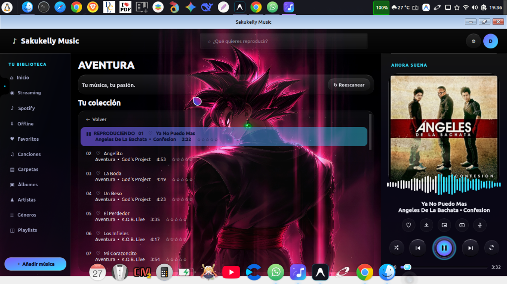
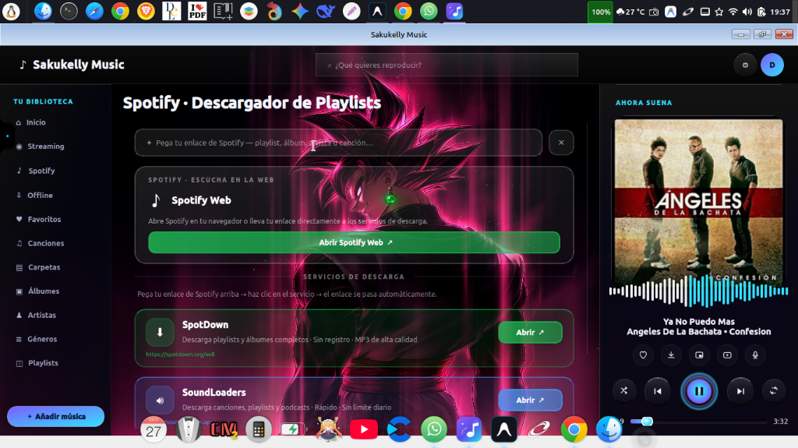
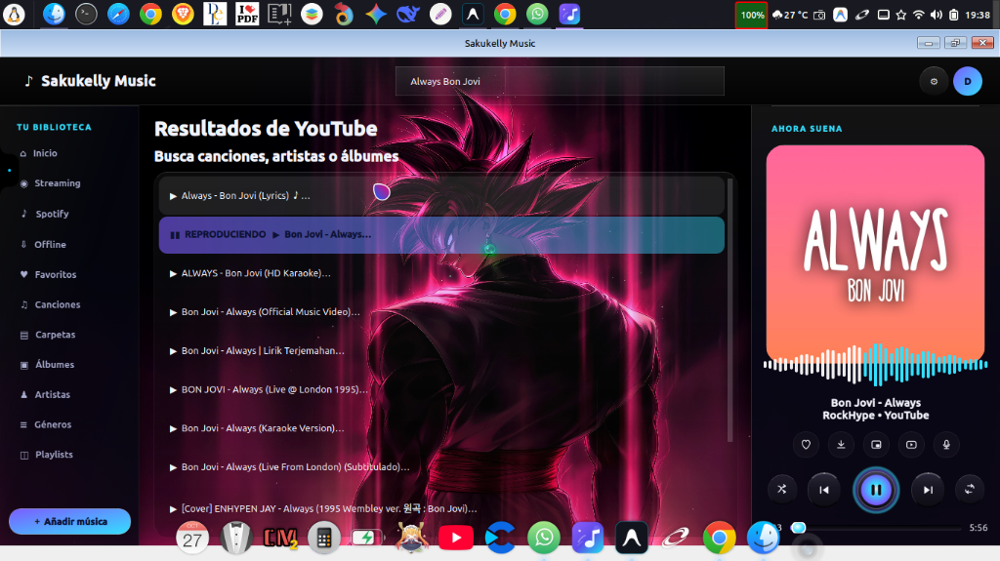

# Sakukelly Music v6.5.2 para Linux

[](https://github.com/darwinsin822/sakukelly-linux/releases)
[](LICENSE)
[-blue.svg?style=for-the-badge&labelColor=0d1117)](https://github.com/darwinsin822/sakukelly-linux)

Reproductor de música avanzado híbrido (local y streaming) escrito en Python 3 con PyQt6, QtMultimedia, `yt-dlp` y `ffmpeg`. Diseñado con una interfaz moderna glassmorphic estilo Apple Music, sincronización de letras a 30 FPS, normalización de volumen ReplayGain (EBU R128), soporte MPRIS D-Bus e instancia única IPC.

---

## 📸 Capturas de Pantalla

<div align="center">

### 🎵 Colección & Reproductor con Espectro de Audio


<br/>

### 🟢 Integración Spotify & Descargador de Playlists


<br/>

### 🔴 Búsqueda y Streaming Directo de YouTube


</div>

---

## ✨ Características Principales

- **Reproducción Híbrida**: Gestión unificada de biblioteca local de archivos (`mp3`, `flac`, `ogg`, `m4a`, `wav`, `opus`) y streaming de audio/vídeo desde YouTube.
- **Letras Sincronizadas (Estilo Apple Music)**:
  - Soporte de archivos `.lrc` locales, etiquetas incrustadas `SYLT`/`Vorbis` y consultas avanzadas a APIs (LRCLIB, Lyrics.ovh).
  - Temporizador de 30 FPS con interpolación de posición de audio y desplazamiento automático centrado.
  - Limpieza de títulos ruidosos de vídeos de YouTube y canales VEVO/Topic.
- **Rendimiento de Streaming Extremo**:
  - Caché en memoria de URLs resueltas (`_STREAM_URL_CACHE`, 45m TTL) y búsquedas (`_SEARCH_CACHE`, 20m TTL).
  - Precarga automática en segundo plano (Pre-fetching) de la siguiente canción de la cola.
- **Motor de Audio Profesional (DSP)**:
  - Ecualizador paramétrico de 10 bandas y procesador de efectos.
  - Normalización de sonoridad inteligente (ReplayGain real vía EBU R128 con `ffmpeg`).
  - Traspaso suave sin pausas (*Gapless playback*) y fundido cruzado (*Crossfade*).
- **Integración con el Sistema Desktop**:
  - Integración nativa D-Bus MPRIS v2 (`org.mpris.MediaPlayer2.sakukelly`) para teclas multimedia globales.
  - Bandeja del sistema (Tray icon) y scrobbling automático a **ListenBrainz** y **Last.fm**.
  - Candado de instancia única IPC vía `QLocalSocket` para evitar ejecución duplicada y transmitir apertura de archivos desde el explorador.

---

## 🛠️ Requisitos e Instalación

### Dependencias de Sistema (Linux/Debian/Ubuntu)
```bash
sudo apt update
sudo apt install -y python3 python3-pyqt6 python3-pyqt6.qtmultimedia python3-dbus ffmpeg
```

### Instalación mediante Paquete Debian `.deb`
Descarga la última versión desde [Releases](https://github.com/darwinsin822/sakukelly-linux/releases):

```bash
sudo dpkg -i sakukelly_6.5.2-1_all.deb
sudo apt install -f  # Para resolver dependencias si fuera necesario
```

---

## 🧪 Pruebas Automatizadas

El proyecto cuenta con una suite completa de pruebas unitarias automatizadas (`tests/`):

```bash
# Ejecutar todas las pruebas unitarias
python3 -m unittest discover -s tests -p "test_*.py" -v
```

---

## 📦 Construcción e Integración Continua (DevOps)

Para construir el paquete `.deb` de forma automatizada y verificada:

```bash
./scripts/build_deb.sh
```

El script ejecuta automáticamente:
1. La suite de pruebas unitarias (`tests/`).
2. Verificación de sintaxis de Python (`py_compile`).
3. Empaquetado final con `dpkg-deb`.

---

## 📄 Licencia

Desarrollado para el proyecto Sakukelly. Licencia MIT.
